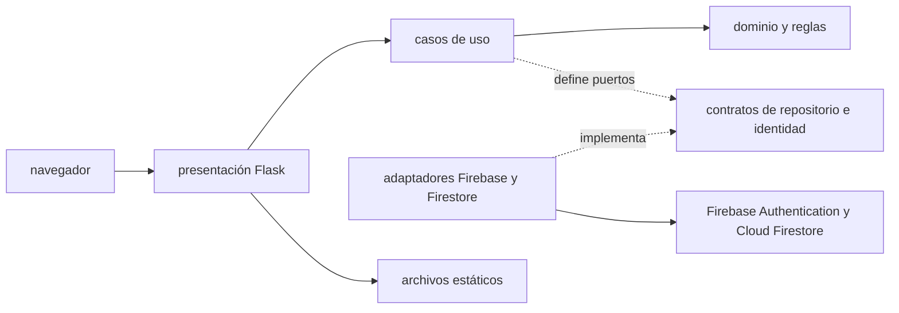

# Arquitectura de RR. HH. Asistencia

## Objetivo

Mantener las reglas del negocio independientes de Flask y Firebase. La capa de infraestructura implementa los puertos que necesita la aplicación; la capa de presentación adapta HTTP y el navegador al formato de los casos de uso.

## Capas

| Capa | Ubicación | Responsabilidad |
|---|---|---|
| Dominio | `backend/rrhh/domain` | Modelos, validaciones y reglas de horas, asistencia y roles. |
| Aplicación | `backend/rrhh/application` | Casos de uso y contratos para identidad y persistencia. |
| Infraestructura | `backend/rrhh/infrastructure` | Inicialización de Firebase Admin, validación de tokens y repositorios Firestore. |
| Presentación | `backend/rrhh/presentation` | Rutas Flask, autenticación HTTP y entrega de archivos estáticos. |
| Interfaz | `index.html`, `static/` | Pantallas web, modo demo y consumo de la API. |

## Dependencias

Las dependencias del código apuntan hacia el dominio: las reglas no importan Flask, Firebase ni Firestore. `create_app()` conecta los casos de uso con los adaptadores concretos. Los errores del dominio no contienen códigos HTTP; `presentation/errors.py` los transforma en respuestas de transporte.

## Flujo de una solicitud protegida

1. El navegador inicia sesión con Firebase Authentication y obtiene un ID token.
2. La presentación exige el token en `Authorization: Bearer ...`.
3. `FirebaseIdentityProvider` valida el token con Firebase Admin SDK.
4. `AccessService` consulta `usuarios_autorizados/{uid}` y verifica que la cuenta esté activa y tenga un rol admitido.
5. La ruta invoca el caso de uso correspondiente.
6. El repositorio Firestore lee o persiste los datos. Los movimientos del banco de horas actualizan el saldo y el historial en una transacción.
7. La presentación convierte el resultado de dominio a JSON.

Los permisos se verifican en el servidor para cada operación. Las reglas de Firestore ofrecen una segunda barrera para operaciones directas de clientes Firebase.

## Casos de uso actuales

- Consultar y crear empleados.
- Consultar los movimientos recientes y acumular o devolver horas.
- Consultar y registrar asistencias.
- Consultar el usuario y rol asociados al token actual.

El modo demo del navegador usa `localStorage` y datos ficticios. No llama a los casos de uso ni a Firestore.

## Punto de entrada y configuración

- `backend.rrhh.create_app()` crea Flask y conecta los servicios.
- `app.py` expone el objeto WSGI `app` y permite ejecutar el servidor local.
- `FirebaseRuntime` crea Firebase Admin de forma diferida, así `/api/health` puede responder sin abrir una conexión a Firestore.
- `FIREBASE_PROJECT_ID` permite elegir el proyecto por entorno; su valor local por defecto es `empleados-cbf0b`.
- Las credenciales se obtienen mediante Application Default Credentials; no se guardan claves privadas en el repositorio.

## Límites conocidos

- La demo pública es estática y no sustituye el backend conectado.
- La carga de horas es manual; el cálculo automático depende de definir jornadas y períodos.
- La consulta de saldos actualmente obtiene el documento de banco por empleado. Si el volumen crece, se podrá optimizar con lecturas por lotes sin cambiar la capa de presentación.
